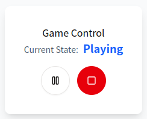
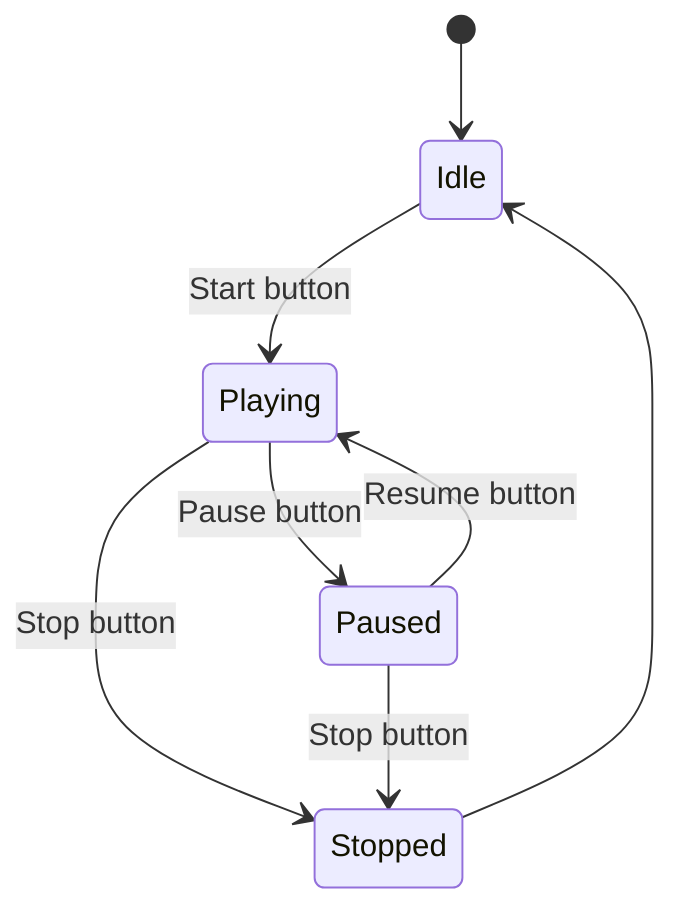

<style>
.slidev-slide-content  {
  background-color: #f5f3e9 !important;
}
</style>
<div class="mb-4 bottom-4 left-12">
  <div class="text-6xl text-primary-lighter text-opacity-80 text-center upper" style="font-weight:500;">
    Finite-State Machines
  </div>
  <div class="text-6xl m-4 text-primary-lighter text-opacity-80 text-center" style="font-weight:500;">
        <twemoji-red-heart class="text-6xl text-red-400 mx-2 animate-pulse"/>
  </div>
  <div class="text-6xl text-primary-lighter text-opacity-80 text-center" style="font-weight:500;">
        <div class="inline-flex">
          <uim-react class="text-6xl text-cyan-300" /><span>React</span>
        </div>
  </div>
  <div class="text-4xl text-primary uppercase text-opacity-60 mt-8 text-right" style="font-weight:400;">
    Ivan Satsiuk 
  </div>
  <pre class="text-xl text-primary text-opacity-40 mt-4 text-right">
    Jan 16, 2026
  </pre>
</div>
  <div class="absolute right-4 bottom-4 text-sm text-black text-opacity-80 mt-6 text-right uppercase">
     Photo by Markus Spiske
  </div>

---
layout: two-cols
---

Game State Control
### Two Buttons:
- **Stop button**: Available when playing or paused → goes to Stopped
- **Start/Pause/Resume button**: Changes label based on state
  - Idle → shows "Start"
  - Playing → shows "Pause"
  - Paused → shows "Resume"
  - Stopped → disabled

<div class="w-full m-4 flex items-center justify-center">
    
</div>

::right::



---
routeAlias: soup
layout: dynamic-image
equal: true
left: false
image: 'images/boolean_soup.jpg'
---
The "Boolean Soup" Problem

````md magic-move
```tsx
function GameControl() {
  const [isIdle, setIsIdle] = useState(true)
  const [isPlaying, setIsPlaying] = useState(false)
  const [isPaused, setIsPaused] = useState(false)

  const handleStart = () => {
    setIsIdle(false);
    setIsPlaying(true);
  };
  const handlePause = () => {
    setIsPlaying(false);
    setIsPaused(true);
  };
}
```
```tsx {5|15-23}
function GameControl() {
  const [isIdle, setIsIdle] = useState(true)
  const [isPlaying, setIsPlaying] = useState(false)
  const [isPaused, setIsPaused] = useState(false)
  const [isStopped, setIsStopped] = useState(false)

  const handleStart = () => {
    setIsIdle(false);
    setIsPlaying(true);
  };
  const handlePause = () => {
    setIsPlaying(false);
    setIsPaused(true);
  };
  const handleResume = () => {
    setIsPaused(false);
    setIsPlaying(true);
  };
  const handleStop = () => {
    setIsPlaying(false);
    setIsPaused(false);
    setIsStopped(true);
  };
}
```
````

<v-click>
    <Link to="fsm" title="*next chapter"/>
</v-click>

---
layout: dynamic-image
equal: true
left: false
image: 'images/conditional_chaos.jpg'
---

Conditional Rendering Chaos

```tsx
function GameControl() {
  return (
    <div>
      <button
        onClick={
          isIdle ? handleStart :
              isPlaying ? handlePause :
              isPaused ? handleResume :
          undefined
        }
      >
        {isIdle ? 'Start' :
             isPlaying ? 'Pause' :
             isPaused ? 'Resume' :
         'Disabled'}
      </button>

      {(isPlaying || isPaused) && (
        <button onClick={handleStop}>Stop</button>
      )}
    </div>
  );
}
```

---
routeAlias: bool-extend
layout: dynamic-image
equal: false
left: false
image: 'images/constrained.jpg'
---

Extensibility Problem

````md magic-move
```tsx
function GameControl() {
  const [isIdle, setIsIdle] = useState(true);
  const [isPlaying, setIsPlaying] = useState(false);
  const [isPaused, setIsPaused] = useState(false);
  const [isStopped, setIsStopped] = useState(false);

  const { data } = useGlobalState(GAME_STATE);

  // ... handlers and rendering ...
}
```

```tsx {|9|9-19|}
function GameControl() {
  const [isIdle, setIsIdle] = useState(true);
  const [isPlaying, setIsPlaying] = useState(false);
  const [isPaused, setIsPaused] = useState(false);
  const [isStopped, setIsStopped] = useState(false);

  // ... handlers and rendering ...

  const { data } = useGlobalState(GAME_STATE);

  useEffect(() => {
    if (isPlaying && data.isPaused) {
        handlePause()
    } else if (isPaused && data.isPlaying) {
        handlePlay()
    }
        // ... more state checks??
  }, [data, isPlaying, isPaused, ...]);
}
```
````
<v-click>
    <Link to="fsm-extend" title="*next chapter"/>
</v-click>

---
layout: two-cols
---

What is FSM?

### Basic Properties

- **Finite set of states**: The system can only be in one state at a time
- **Initial state**: Where the system starts
- **Transitions**: Rules for moving between states
- **Events**: Triggers that cause state changes
- **Deterministic**: Same event in same state always leads to same next state
<br>
<br>
<br>
- [Wiki: Finite-state machine](https://en.wikipedia.org/wiki/Finite-state_machine)
- [Event-driven finite-state machine](https://en.wikipedia.org/wiki/Event-driven_finite-state_machine)
::right::


---
layout: two-cols
---

`React.useReducer()`

### Main Properties

- **State management**: Alternative to useState
- **Reducer function**: Pure function
- **Actions**: Objects that describe what happened
- **Dispatch**: Function to send actions to the reducer
- **Predictable**: Same state + action always produces same result

<br>

- [React useReducer Documentation](https://react.dev/reference/react/useReducer)

::right::

```tsx
// Reducer function
function reducer(state, action) {
  switch (action.type) {
    case 'inc':
      return { count: state.count + 1 };
    case 'dec':
      return { count: state.count - 1 };
    default:
      return state;
  }
}

// Usage in component
function Counter() {
  const [state, dispatch] = useReducer(
    reducer,
    { count: 0 }
  );

  return (
      <button onClick={() => dispatch({ type: 'inc' })}>
          Count: {state.count}
      </button>
  );
}
```

---
layout: two-cols
---

Reducer Function

```tsx {3-5|6-9|10-13|14-15|1-19|12}
function reducer(state, {type}) {
  switch (state.status) {
    case 'idle':
      if (type === 'START') return { status: 'playing' };
      return state;
    case 'playing':
      if (type === 'PAUSE') return { status: 'paused' };
      if (type === 'STOP') return { status: 'stopped' };
      return state;
    case 'paused':
      if (type === 'RESUME') return { status: 'playing' };
      if (type === 'STOP') return { status: 'stopped' };
      return state;
    case 'stopped':
      return {status: 'idle'};
    default:
      return state
  }
}
```
<v-click>
    <Link to="soup" title="Boolean Soup"/>
</v-click>
::right::


<style>
.two-cols {
  column-gap: 20px; /* Adjust the gap size as needed */
}
</style>

---
routeAlias: fsm
layout: two-cols-header
---

FSM with `useReducer()`

::left::
```tsx {2|4-5|7|11-20|}
function GameControl() {
  const [state, dispatch] = useReducer(reducer, { status: 'idle' });

  const mainConfig = buttonConfig[state.status];
  const stopConfig = stopButtonConfig[state.status];

  const handleAction = useCallback((type) => dispatch({ type }), []);

  return (
    <div>
      <button onClick={handleAction(mainConfig.action)}>
        {mainConfig.label}
      </button>

      {stopConfig && (
        <button onClick={handleAction(stopConfig.action)}>
          {stopConfig.label}
        </button>
      )}
    </div>
  );
}
```
::right::
```tsx
const buttonConfig = {
    idle: { label: 'Start', action: 'START' },
    playing: { label: 'Pause', action: 'PAUSE' },
    paused: { label: 'Resume', action: 'RESUME' },
    stopped: { label: 'Start', action: 'START' },
};

const stopButtonConfig = {
    playing: { label: 'Stop', action: 'STOP' },
    paused: { label: 'Stop', action: 'STOP' },
};
```
<v-click>
    <Link to="soup" title="Boolean Soup"/>
</v-click>

<style>
.two-cols-header {
  column-gap: 20px; /* Adjust the gap size as needed */
}
</style>


---
routeAlias: fsm-extend
layout: dynamic-image
equal: false
left: false
image: 'images/unconstrained.jpg'
---

Extending with `useReducer()`

```tsx {|9|10-13|}
function GameControl() {
  const [state, dispatch] = useReducer(reducer, { status: 'idle' });

  const mainConfig = buttonConfig[state.status];
  const stopConfig = stopButtonConfig[state.status];

  const handleAction = useCallback((type) => dispatch({ type }), []);

  const { data } = useGlobalState(GAME_STATE);

  useEffect(() => {
   if(data.status) handleAction(data.status)
  }, [data.status])
  // ...
}
```
<v-click>
    <Link to="bool-extend" title="*previous chapter"/>
</v-click>

---
layout: two-cols-header
---

## Pros & Cons
::left::
### Pros ✅

<v-click>

- **No impossible states**: Type system prevents invalid combinations

</v-click>
<v-click>

- **Explicit transitions**: All state changes are clearly defined

</v-click>
<v-click>

- **Easy to test**: Pure reducer function, predictable outputs

</v-click>
<v-click>

- **Scalable and Reusable**: Handles complex state logic gracefully

</v-click>
<v-click>

- **Self-documenting**: State machine structure is clear

</v-click>
<v-click>

- **Better debugging**: Track state transitions easily

</v-click>

::right::

### Cons ❌

<v-click>

- **More boilerplate**: Initial setup is verbose

</v-click>
<v-click>

- **Learning curve**: Requires FSM understanding

</v-click>
<v-click>

- **Overkill for simple cases**: Single boolean toggle doesn't need FSM

</v-click>
<v-click>

- **Type definitions**: Can be verbose with TypeScript

</v-click>

